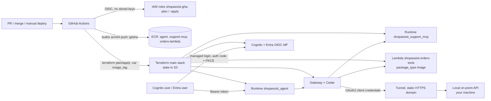

# ShopAssist: production deploy pipeline (PLAN, approved)

Status: **approved 2026-11-06**. The work is tracked in [`prod-deploy-tasks.md`](prod-deploy-tasks.md).

## 1. Context

The PoC has been verified with two deploy paths (Terraform and boto3) and with zip ("direct code") artifacts. The
next step is a production-style delivery:

| # | Request | Outcome |
|---|---|---|
| 1 | Remove everything deployed by boto3 | The boto3 stack in **438750401181** is destroyed and the boto3 code path is removed from the repo |
| 2 | No more zips | All three workloads (agent, support MCP, orders Lambda) ship as **arm64 container images in ECR** |
| 3 | CI/CD pipeline (**GitHub Actions**) | A workflow runs test → build → push → `terraform plan` → approval → `terraform apply` → smoke test |
| 4 | Entra ID sign-in | Microsoft Entra ID users sign in through Cognito (federated) **alongside** the existing Cognito users |
| 5 | Terraform only | Terraform is the single source of truth, **including image rollouts**. Tasks are re-ordered |
| 6 | Simulated on-prem API | A local API on your machine, called by the agent running in AWS, with proper security |

### Accounts (fixed)
- **Deployments:** `438750401181`, AWS profile `personal` (IAM user `kalyanfromusa`, keys in `~/.aws/credentials`). It is used, per command, to
  access and deploy the app. **Strict rule:** it is never used to run the Claude session itself (session settings,
  env or model access), and never as a fallback when the session's token expires. Tasks that use it are marked 🔑.
- **Claude session:** `923746767156` (default `AWS_PROFILE`). Nothing is ever deployed there.
- Current state (checked read-only on 2026-11-06): the **boto3 stack is live** in 438750401181. That's the runtimes
  `shopassist_agent` and `shopassist_support_mcp` (READY), the Gateway `shopassist-gateway`, 3 DynamoDB tables,
  the Lambda `shopassist-orders-tools`, the artifacts bucket, `shopassist-pool` and 4 `shopassist-*` IAM roles. It
  is billed by usage while idle, plus storage. The account also has an unrelated CDK bootstrap ECR repository,
  `cdk-hnb659fds-…`, which is left alone.
- Security note: `personal` holds **long-lived access keys** for an IAM user. CI never uses them (GitHub uses
  OIDC). Locally, consider MFA or moving to SSO later.

## 2. Target architecture

What stays the same: the generic agent, the skills, the hybrid skill→tool binding, the Gateway naming
(`<target>___<tool>`), the per-user Runtime claim check, Cedar policies, and `.deploy/outputs.json` (now
written by Terraform only).

## 3. Design by request

### 3.1 Remove boto3 (request 1)
1. Run `infra/boto3/destroy.py --yes` with `AWS_PROFILE=personal`.
   It finds resources by name, so a lost `state.json` doesn't matter.
2. Check for leftovers by name: the tagging API (`project=shopassist`), log groups (`MSYS_NO_PATHCONV=1`),
   the IAM roles `shopassist-*`, the Cognito pool, the S3 bucket and the budget.
3. Delete `infra/boto3/`, `tests/test_boto3_shapes.py`, `docs/05-deploy-boto3.md` and `docs/06-terraform-vs-boto3.md`
   (kept as a short "historical note" section in `docs/04`). Remove boto3 references from the README,
   `docs/03`, `docs/09` and the steering files. Update `decisions.md` with a dated entry that supersedes
   "Both Terraform and boto3" and "Direct-code (zip)".
4. Clear the stale `.deploy/` files. Terraform rewrites them.

### 3.2 Container images instead of zips (request 2)
- Images: `shopassist-agent`, `shopassist-support-mcp` (existing Dockerfiles), and a **new**
  `mcp_servers/orders_lambda/Dockerfile` based on `public.ecr.aws/lambda/python:3.12-arm64`.
- Dependencies are **pinned** from `uv.lock` (`uv export --frozen --no-hashes` per image), so that two builds of
  one commit are identical.
- Tags are `:<full git sha>` only. There's no `latest` in prod, ECR tags are **immutable** and scan on push is on.
  **ECR keeps exactly 2 images per repo: current + previous** (decided 2026-11-06). That's why only the deploy job pushes,
  and a failed deploy deletes what it pushed. Rollback = one step back.
- Terraform: the `agent_runtime` and `mcp_runtime` modules switch to
  `agent_runtime_artifact { container_configuration { container_uri } }`. The `lambda_tools` module switches to
  `package_type = "Image"`, `image_uri`, arm64. `modules/data` stops uploading zips, and the bucket now only
  holds `skills/`.
- Removed: `scripts/build.py`, `tests/test_build.py`, `dist/`, the `artifact_type` switch idea
  (`docs/ci-cd-integration-patch.md`), and `scripts/ci/update_runtime_image.py` with its test (Terraform now does
  rollouts, see 3.4).
- Note: the first switch from code to container **replaces** both runtimes (new ids). That doesn't matter here,
  because the stack is created fresh.

### 3.3 GitHub Actions pipeline (request 3)
This builds on what already exists (`.github/workflows/deploy.yml`, `infra/terraform/ci/oidc.tf`, the Dockerfiles).
The big change is that the pipeline now **runs Terraform** instead of calling `UpdateAgentRuntime` itself.

- **AWS auth: GitHub OIDC, no stored AWS keys.** There are two roles in 438750401181, both defined in Terraform
  (`platform/`):
  - `shopassist-gha-plan`: read-only plus state-bucket access (read, and lock-file write). It is trusted for
    `pull_request` and for `main`. It can run `terraform plan`, but can't change anything.
  - `shopassist-gha-apply`: least privilege for the resources the stack manages (scoped to `shopassist-*` names,
    with `iam:PassRole` limited to the stack's roles). It is trusted **only** for
    `sub = repo:kalyanfromusa/strands-agent-mcp-skills-poc:environment:prod`, so only a job running in the
    protected `prod` environment can assume it.
- **Approval gate:** a GitHub **environment `prod`** with required reviewers (you), `main` as the only deployment
  branch, and an optional wait timer. The apply job waits there until it's approved.
- **Workflows:**
  - `ci.yml` (on pull requests): `uv run pytest`, `terraform fmt -check` / `validate`, `tflint`, `checkov`
    (soft-fail at first), image builds without push, and a **summary-only** `terraform plan` against prod (with
    `image_tag` = the PR head SHA, role `gha-plan`, same-repo PRs only, skipped for forks) posted as a PR comment.
  - `build.yml` (on push to `main` after a merge): tests, then build and scan the images. It **doesn't push or deploy**
    (so ECR only ever holds deployed images). The job summary prints the SHA that is ready to deploy.
  - `deploy.yml` (**manual only**, `workflow_dispatch`; **no automatic deploy on merge**). Inputs: `target_env`
    (`prod` by default; `dev` stays off) and `image_tag` (a 40-hex SHA whose images exist in ECR, by default the
    head of `main`):
    1. **test**: pytest + IaC checks on the chosen commit
    2. **build-and-push** (only if the images for that SHA are missing): a matrix over the 3 images, on native `ubuntu-24.04-arm` runners (QEMU fallback via
       `USE_QEMU`), `buildx --platform linux/arm64 --provenance=false`, GHA layer cache, **Trivy** scan
       (fails on HIGH/CRITICAL), push `:<sha>` (skipped if the tag already exists; tags are immutable)
    3. **plan** (role `gha-plan`): `terraform plan -var image_tag=<sha> -out tfplan`. The plan file is uploaded as a
       short-lived artifact and the summary goes to the job summary.
    4. **apply** (`environment: prod`, role `gha-apply`): waits for approval, downloads **that exact plan**, then
       `terraform apply tfplan`. Terraform also synchronizes the Gateway targets (`support`, `onprem`) through a
       `terraform_data` + `local-exec`, so this is still part of the apply.
    5. **smoke**: `scripts/demo_access.py --no-reseed --only b,c,d`, with `.deploy/` files rebuilt from
       environment secrets
- **Rollback:** run `deploy.yml` with `image_tag = <older full SHA>`. That skips the build, checks the
  images exist, and goes through plan → approval → apply with that tag. Reverting the commit works too.
- **Secrets** are **environment secrets** on `prod`: the Entra client secret (`TF_VAR_entra_client_secret`), the
  smoke-test users file and the tunnel token if it's needed. None of them are in git or in logs (`::add-mask::`).
  The non-secret ids are repository/environment *variables*.
- **Public repo log hygiene:** plan steps run `terraform plan -out tfplan > /dev/null`, then print only
  `terraform show -json tfplan | jq` → "address: action" lines and counts. Apply runs with output captured to a
  file, which isn't uploaded, and prints only the summary and errors. Plan artifacts are encrypted with a key held
  in an environment secret before upload (`age`/`openssl`), or not uploaded at all, with the apply job
  re-planning and comparing the summary hash with the approved one.
- **Hygiene (kept from today):** actions pinned to SHAs, `permissions: id-token: write, contents: read`
  (plus `pull-requests: write` only for the PR-comment job), `persist-credentials: false`, a `concurrency`
  group with no cancelling half-way through an apply, and the `image_tag` input validated as 40 hex characters.
- Removed: `scripts/ci/update_runtime_image.py` and its test (Terraform does rollouts now). The old
  `ignore_changes` / `artifact_type` design is dropped.

### 3.4 Terraform as the single deploy path (request 5)
Three Terraform roots, applied in this order:

| Root | Contains | State |
|---|---|---|
| `infra/terraform/bootstrap/` | S3 state bucket (no versioning, encrypted, public access blocked) | local (tiny, git-ignored) |
| `infra/terraform/platform/` (replaces `ci/`) | 3 ECR repos, the GitHub OIDC provider, the roles `shopassist-gha-plan` and `shopassist-gha-apply` | S3 backend, `use_lockfile = true` |
| `infra/terraform/` (main stack) | everything that exists today + the Entra IdP + the on-prem target | S3 backend, `use_lockfile = true` |

- New variable `image_tag` (required, a 40-hex validation). The image URIs are built from the platform outputs
  (`terraform_remote_state`) or from variables. There's **no `ignore_changes`**: an image change is an
  in-place runtime update done by `terraform apply`.
- Environment values go in `envs/prod.tfvars` (committed, no secrets). Secrets come in through `TF_VAR_*`
  from GitHub environment secrets.
- `terraform destroy` of the main stack, then platform, then bootstrap removes everything (cost hygiene).
- **Environments (Q7): dev and prod are defined, only prod is deployed.**
  - New variable `environment` (`dev` | `prod`). Names become `shopassist-<env>-*`, for example
    `shopassist-prod-orders`, the runtime `shopassist_prod_agent` and the Gateway `shopassist-prod-gateway`, so
    the two environments could live side by side in 438750401181. This is a naming contract change (`design.md` §1).
  - `envs/dev.tfvars` + `envs/prod.tfvars`, with **separate state keys** (`main/dev.tfstate`, `main/prod.tfstate`)
    via `-backend-config=envs/<env>.backend.hcl`.
  - `platform/` is shared: one set of ECR repos. An image is **built once and promoted** by SHA, so dev and prod
    run the same bytes. There is one apply role **per environment**, each trusted only for
    `environment:<env>`.
  - GitHub environments `dev` (no reviewer) and `prod` (reviewer = you). `deploy.yml` has a `target_env` input,
    default `prod`, and the dev jobs are present but switched off by the repo variable `DEPLOY_DEV=false`.
  - Entra: one app registration per environment (`ShopAssist-Dev`, `ShopAssist-Prod`), groups
    `AD-ShopAssist-Dev-*` / `AD-ShopAssist-Prod-*`, and the same `AppRole-` / `Group-` values. Only the prod ones are
    created now. The dev ones are listed in `docs/12` as a to-do.
  - Verification for dev: `terraform plan -var-file=envs/dev.tfvars` succeeds (nothing is applied).

### 3.5 Entra ID federation, with rights driven by Active Directory groups (request 4)
**Goal:** what a user may do in ShopAssist is decided by their **Active Directory group membership**, and
nothing in AWS has to change when people join or leave a group:

**Naming convention** `<Layer>-<Application>-<Env>-<Role>`: the prefix says which system the name lives in.
AD groups are plural (they hold people). App roles and Cognito groups are singular (each names one permission level).

| Layer (prefix) | Lives in | Represents | Has members? | Admin | Viewer |
|---|---|---|---|---|---|
| `AD-` AD security group | On-prem AD (synced to Entra) or Entra | **who**: the people | **yes**, maintained by the AD/helpdesk team | `AD-ShopAssist-Prod-Admins` | `AD-ShopAssist-Prod-Viewers` |
| `AppRole-` Entra app role (value) | The Entra app registration `ShopAssist-Prod` | **what the app offers**: a permission the app understands | no (groups are *assigned* to it, once) | `AppRole-ShopAssist-Admin` | `AppRole-ShopAssist-Viewer` |
| `Group-` Cognito group | Cognito user pool group + `cognito:groups` claim, checked by the Runtime and Cedar | **what AWS enforces**: the tool permissions | Cognito-native demo users only; Entra users get it in the token at sign-in | `Group-ShopAssist-Admin` | `Group-ShopAssist-Viewer` |

The rights: `Group-ShopAssist-Admin` gets all tools (like alice), `Group-ShopAssist-Viewer` gets read-only tools
(like bob), and a user with no role is blocked (Entra "assignment required", or a 401/403 at the Runtime, like carol).

- **The environment** is only in the per-environment names, the AD groups and the app registration. If dev is
  added later, it gets `AD-ShopAssist-Dev-*` and `ShopAssist-Dev`, with the **same** `AppRole-` and `Group-` values,
  so the code and policies don't change between environments.
- Being in both groups gives admin (the highest role wins). A new role, such as `Support`, is one AD group, one
  app role, one Cognito group, one line in the mapping and one Cedar policy.
- **Contract change:** `shop-admin` / `shop-viewer` are renamed to `Group-ShopAssist-Admin` /
  `Group-ShopAssist-Viewer` everywhere: the Cognito groups, the Runtime `allowed_groups`, the Cedar policies,
  the demo users, `local_gateway.py --role`, the tests and `design.md` §8. This is done in P0/P5.

**What each layer is for**
- **AD group:** how the organisation manages people. Joiners, movers and leavers already go through it.
- **App role:** the app's own access contract inside Entra. It's used in three places:
  1. **The Entra portal** (Enterprise applications → ShopAssist-Prod → Users and groups → *Add assignment*): this is
     where access is granted. Pick an AD group (or a single user) and choose `AppRole-ShopAssist-Admin` or `-Viewer`. With
     "Assignment required = Yes", it is also the gate: anyone without a role can't sign in to the app at all.
  2. **The sign-in token:** Entra puts only this app's roles into the `roles` claim (`["AppRole-ShopAssist-Admin"]`),
     not the user's hundreds of groups. That keeps tokens small and avoids leaking the org structure.
  3. **Governance:** Entra access reviews, access packages, sign-in and audit logs, and "My Apps" all work on app
     role assignments, so "who has admin on ShopAssist?" is one screen in Entra.
  It also decouples the two sides. AD groups can be renamed or merged, or several groups can share one role
  (for example `AD-Support-Leads` also gets Admin), and nothing in AWS changes.
- **Cognito group:** the vocabulary AWS enforces. AWS doesn't trust Entra's claims directly. They are translated
  once, at the trust boundary (the role-mapper Lambda, which keeps an allow-list), so Cognito users and Entra users,
  and any future IdP, all end up with the same roles that the Runtime and Cedar check.

**Where the groups live** (Q5): either
- **on-premises Windows Server AD**, synced to Entra by Entra Connect / Cloud Sync, with membership managed in
  "AD Users and Computers" as usual (changes reach Entra at the next sync, about 30 min by default), or
- **cloud-only Entra security groups**, if there is no on-prem AD. Everything downstream is identical.

**Getting an Entra tenant for the PoC (no local install, free options)**
Entra is a cloud service, so nothing is installed locally. You need a browser for sign-in and, optionally,
`az` CLI or the Terraform `azuread` provider to script the app registration.
- **Tenant:** a free Azure account creates a tenant with **Entra ID Free**. That covers app registrations, app
  roles, OIDC to Cognito, and assigning *users* to app roles.
- **Group → app role** (the standard approach) needs **P1**. For the build and demo, use the **Entra ID P2 30-day
  free trial** (Entra admin center → Billing → Licenses → All products → Try/Buy).
- **After the trial:** the role mapper has a switch, `entra_role_source = "roles" | "groups"`. In `groups` mode
  (Entra ID Free) it reads the `groups` claim and maps the AD groups to `Group-*`. The `AppRole-` layer disappears,
  and nothing else changes. The map keys are the `sAMAccountName` (`AD-ShopAssist-Prod-Admins`) for groups
  synced from on-prem AD, or the group **object id** for cloud-only groups (Entra Free can't emit cloud group
  names). Limits, all handled fail-closed (a user with no matching group gets no role): users in more than 200
  groups get an "overage" token with no group list, and Cognito custom attributes hold at most 2048 characters
  (about 50 group ids), so the groups claim is limited to security groups. "Assignment required" has to be off
  (Free can't assign groups to an app), so any tenant user can sign in but is blocked at the Runtime.
- **On-prem AD (optional, free):** Windows 11 Pro has Hyper-V, so you can run a **Windows Server Evaluation**
  VM (180 days free), promote it to a domain controller, create the `AD-*` groups and users, and sync them with
  **Entra Cloud Sync** (a free agent on the VM). Without it, create the `AD-*` groups as cloud-only Entra groups.
  Everything downstream is identical.

**How a group becomes a right** (one chain, every link configured by code or a documented step):
1. **Entra app registration** `ShopAssist-Prod` (documented step by step in `docs/12-entra-federation.md`): redirect URI
   `https://shopassist-<acct>.auth.us-east-1.amazoncognito.com/oauth2/idpresponse`, a client secret, and
   two **app roles** (value / display name): `AppRole-ShopAssist-Admin` / "ShopAssist Admin" and `AppRole-ShopAssist-Viewer` /
   "ShopAssist Viewer", allowed member type *Users/Groups*.
2. **Enterprise application → Users and groups:** assign each AD group to its app role. Set "Assignment
   required = Yes", so users outside both groups can't even get an Entra token for the app.
   App roles are better than the raw `groups` claim here. The token carries only the 1–2 relevant role
   names instead of every group the user belongs to, so it avoids the 200-group "overage" problem, and the
   values are stable names instead of tenant-specific object ids. Assigning *groups* to app roles needs
   **Entra ID P1** or higher. The fallback without P1 is the `groups` claim, emitted as `sAMAccountName` for
   synced AD groups, with the mapping done on group names.
3. **Cognito OIDC IdP** `EntraID` (Terraform `aws_cognito_identity_provider`, issuer
   `https://login.microsoftonline.com/<tenant>/v2.0`, scopes `openid email profile`). Attribute mapping:
   `email`, `name`, and `roles` → custom attribute `custom:entra_roles`. Cognito refreshes the mapped
   attributes on **every** federated sign-in, so a group change takes effect at the user's next sign-in.
4. **Pre-token-generation Lambda** `shopassist-role-mapper` (a container image, in Terraform). It reads
   `custom:entra_roles` and sets `cognito:groups` from a Terraform variable such as
   `entra_role_map = { "AppRole-ShopAssist-Admin" = "Group-ShopAssist-Admin", "AppRole-ShopAssist-Viewer" = "Group-ShopAssist-Viewer" }`. The code holds
   no tenant data. Native Cognito users (alice/bob/carol) pass through unchanged. Unknown roles are dropped,
   and each decision is logged without the token.
5. **Unchanged downstream:** the Runtime custom-claim check (`cognito:groups` contains admin/viewer), the Gateway
   authorizer and the Cedar policies. An AD admin and alice look identical to them.

**Taking rights away:** remove the user from the AD group. After the AD→Entra sync and the user's next sign-in,
the new token no longer carries the role. To make that bounded, the users client's access-token lifetime
drops from 60 to **15 minutes** (a refresh re-runs the trigger and re-reads the attributes) and the refresh
token lifetime to 8 hours. For an immediate cut-off: disable the user in AD/Entra and call Cognito
`AdminUserGlobalSignOut` (a documented runbook step).

**To verify during the build:** that the V1 trigger's `groupOverrideDetails` reaches the **access** token (the
Runtime and Gateway check the access token). If it doesn't, I'll use the V2 trigger, which needs the Cognito
**Essentials** tier, and add that to the cost page.
- **Users app client:** keep `USER_PASSWORD_AUTH` for alice/bob/carol, and add the authorization-code flow with
  PKCE, `supported_identity_providers = ["COGNITO", "EntraID"]`, and loopback callback URLs.
- **Clients:** `scripts/invoke_agent.py --login` and `scripts/chat_ui.py` get a "Sign in" button. Both use
  managed login + PKCE through a loopback redirect (`http://localhost:8790/callback`). The existing
  `--user alice` path keeps working.
- Demo matrix: `demo_access.py` adds optional scenarios run with three AD test users: `e1` AD admin → all 7+
  tools, `e2` AD viewer → read-only, `e3` a user in no ShopAssist group → blocked by Entra ("assignment
  required") or 401/403 at the Runtime. Plus a revocation test: move `e1` to the viewer group, sign in
  again, and `create_return` is gone.

### 3.6 Simulated on-prem API (request 6)
- **What:** `onprem_api/`, a small FastAPI "warehouse system" running on your machine, for example
  `GET /stock/{sku}` and `GET /restock-eta/{sku}`, read-only, with its own seed data. It's exposed with an
  OpenAPI spec.
- **How AWS reaches it:** an outbound-only tunnel with a **stable HTTPS hostname** (Q4). No inbound port opens
  on your network, which mirrors the "private connector" pattern.
- **Gateway:** a new target `onprem` of type **OpenAPI**, with outbound auth **OAuth2 client credentials**
  through AgentCore Identity. A dedicated Cognito M2M client `shopassist-onprem` gets scope `onprem/read`.
- **API security (defense in depth):**
  1. TLS ends at the tunnel edge, and the local hop is `127.0.0.1` only.
  2. JWT validation on every request: Cognito JWKS signature, `iss`, `token_use=access`, `client_id ==
     shopassist-onprem`, scope `onprem/read`, expiry. Anything else gets 401/403.
  3. Optional tunnel-level access policy (a service token or IP allowlist, depending on the provider).
  4. Rate limiting, request size limits, structured audit logs (caller `client_id`, tool, status) and no
     stack traces in responses.
- **Agent side:** a new skill `skills/inventory-check/SKILL.md` with `mcp-servers: "onprem"`. Cedar allows
  `onprem___*` read tools for both admin and viewer. `local_gateway.py` gets an `onprem___*` emulation, so the
  local run keeps working.
- **Resilience:** when the tunnel or laptop is offline, the tool returns a clean error, and the skill tells the
  model to say "the warehouse system is unreachable right now" without inventing stock numbers (as the UX
  standard requires).

## 4. Phases (re-ordered task list → becomes `prod-deploy-tasks.md`)

| Phase | Work | Verified by |
|---|---|---|
| P0 | Contracts first: update `design.md` (naming, images, roots, Entra, onprem), `decisions.md`, `tech.md`, `structure.md` | review |
| P1 | Tear down the boto3 stack in 438750401181 and check for leftovers | name-based leftover checks are empty |
| P2 | Remove the boto3 code, the zip build and `update_runtime_image.py`; clean up docs and tests | `uv run pytest` green |
| P3 | Terraform `bootstrap` + `platform` (state bucket, ECR, GitHub OIDC provider, plan/apply roles) | `validate`, `apply` in 438750401181 |
| P4 | Images: pinned requirements, Lambda Dockerfile, container checks as a CI script (built in GitHub only) | the checks pass in CI (P6) |
| P5 | Main stack switched to containers + S3 backend + `image_tag` (code + plan only) | `validate`, prod/dev plans succeed |
| P6 | GitHub Actions + **first prod deploy**: `ci.yml`, `build.yml` and a manual `deploy.yml`, the `prod` environment with reviewers, secrets/variables; a PR run, a merge (build only, nothing deployed), a manual deploy of the new SHA, a rollback run | PR shows the summary-only plan comment; the merge deploys nothing; the approved deploy is green and the runtime shows the new image; rollback restores the old one; the plan role can't apply |
| P7 | Entra federation with AD-group rights: app roles + group assignment, Cognito IdP, role-mapper Lambda, PKCE login in CLI and chat UI | AD admin/viewer get the right tools; a user in no group is blocked; the revocation test passes |
| P8 | On-prem API + tunnel + `onprem` Gateway target + skill + Cedar | the agent answers a stock question from AWS; an unauthenticated direct call to the API gets 401 |
| P9 | End-to-end through GitHub Actions (all demo scenarios incl. AD users and on-prem). Prod **stays deployed**; a full `terraform destroy` (main → platform → bootstrap) is checked as a dry run (`plan -destroy`) and only run when you ask | every scenario ✅; the destroy plan covers every `project=shopassist` resource |
| P10 | **Documentation update (last, so it records what was actually verified):** README; `docs/03-architecture` (new diagram: images, GitHub Actions, Entra/AD, on-prem); `04-deploy-terraform` rewritten (3 roots, state backend, `image_tag`, the two accounts/profiles); `10-ci-cd` rewritten (Terraform-driven GitHub Actions: OIDC roles, `prod` environment and approval, secrets, rollback); new `12-entra-federation` (Entra/AD admin runbook, role mapping, revocation); new `13-onprem-api` (tunnel, security layers, offline behavior); `07-cost`, `09-troubleshooting` (new failure modes), `11-chat-ui` (sign-in button); remove `05`/`06`/`ci-cd-integration-patch.md`; update the steering files (`tech`, `structure`, `decisions`), `design.md` and `CLAUDE.md` references; a "Verified run" section with dates and results | docs review; every command in the docs was run in P5–P9; no links to removed files (`grep`) |

## 5. Rough cost (while deployed)
Same as today for AgentCore/Lambda/DynamoDB (consumption-based). Additions: ECR ≈ $0.30/month, the S3 state bucket
costs cents, and GitHub Actions is free for public repos (private repos use plan minutes; arm64 runners are billed at their own rate). Cognito Lite is free for this number of users (Essentials only if the
V2 trigger is needed). The tunnel is free on the provider's free tier.

## 6. Decisions (all answered 2026-11-06)
- **Q1 Repo (decided):** `kalyanfromusa/strands-agent-mcp-skills-poc`, **public**. Native `ubuntu-24.04-arm` runners
  and Actions minutes are free. Consequence: **workflow logs and artifacts are public**, so the pipeline prints
  only plan *summaries* (resource address + action), never full plan or apply output (see 3.3).
- **Q2 Approval (decided):** required reviewer = you, on the `prod` environment (free for public repos).
- **Q3 PR plans (decided):** the repo stays **public**. **Summary-only** plans on same-repo PRs (skipped for forks).
  **No automatic deploy on merge**: a merge only builds and pushes images, and deploying is a manual `deploy.yml`
  run followed by approval on `prod`.
- **Q4 Tunnel (decided):** **ngrok**, using the free static domain (no domain is owned). The tunnel URL is one
  variable per environment, `onprem_api_base_url`, so switching to Cloudflare Tunnel or your own domain later is a
  tfvars change plus `apply`, with no code change. ngrok free gives **one** static domain, which is enough for the
  prod-only deployment; dev would need a second one, or a paid ngrok plan or your own domain. Later, a single owned
  domain could serve every hostname: `onprem-prod.<domain>`, `onprem-dev.<domain>`, and optionally the Cognito
  custom sign-in domain `auth.<domain>` (which needs an ACM certificate in us-east-1).
- **Q5 Entra (decided):** **cloud-only** Entra security groups (no on-prem AD and no Hyper-V DC). A new free tenant,
  OIDC, and you create the app registrations, groups and test users yourself (`docs/12` is the runbook).
  `entra_role_source = "roles"` during the P2 trial. After it ends, `"groups"` mode keys the map on group
  **object ids**.
- **Q6 On-prem API (decided):** warehouse stock / restock ETA.
- **Secrets (decided 2026-11-06):** GitHub **environment secrets** on `prod`, protected by deployment branch `main` and
  required reviewer. No app secrets in AWS Secrets Manager. AWS access is OIDC only. 2FA on the GitHub account.
- **Q7 Environments (decided):** **dev and prod are both fully defined, but only prod is deployed.** See 3.4.
