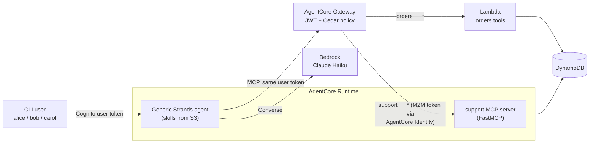

# ShopAssist: a generic, skills-driven agent on Amazon Bedrock AgentCore

ShopAssist is a low-cost proof of concept for architects and engineers evaluating **AgentCore Runtime,
Gateway, Identity and Policy**, and comparing **Terraform vs boto3** delivery.

- A **generic Strands agent** with no business logic runs on AgentCore Runtime. Its behaviour comes
  from **skills** (`skills/*/SKILL.md`, loaded at runtime from S3 with the Strands `AgentSkills` plugin).
- Data and rule enforcement come from **MCP tools** behind **AgentCore Gateway**: a Lambda target
  (`orders`) and a FastMCP server on AgentCore Runtime (`support`).
- **Per-user access control** is enforced outside the agent: Runtime JWT claim check → token
  passthrough → Gateway JWT → AgentCore Policy (Cedar, `tools/list` filtered per user).
- You can deploy it with **Terraform or boto3**. Both produce the same `.deploy/outputs.json`.

The use case is customer support for a fictional online store: order status, returns and refunds,
and support tickets.

## Architecture in 30 seconds



Details: [docs/03-architecture.md](docs/03-architecture.md).

## Demo users

| User | Cognito group | Agent access | Tools |
|---|---|---|---|
| `alice` | `shop-admin` | ✅ | All 7 |
| `bob` | `shop-viewer` | ✅ | Read-only: `get_order`, `list_customer_orders`, `check_return_eligibility`, `get_ticket`, `search_faq` |
| `carol` | none | ❌ HTTP 403 at the Runtime, before any agent code runs | None |

The deploy creates these users with random passwords in `.deploy/users.json` (git-ignored).

## Quick start

### Local (no AWS deployment, real Bedrock)

You need [uv](https://docs.astral.sh/uv/) and AWS credentials that can invoke
`us.anthropic.claude-haiku-5-5` in `us-east-1`:

```bash
uv sync
uv run python scripts/local_gateway.py --port 8765                        # terminal 1: Gateway emulator, in-memory data
uv run python scripts/run_local.py --gateway-url http://localhost:8765/mcp  # terminal 2: chat with the agent
```

Try "Where is order 1042?", "I want to return the headphones from order 1042", "Can I return the
smartwatch from order 1004?" or "My order 1006 hasn't arrived, I'm C003". The emulator's default port
is 8000, so pass `--port` if 8000 is taken. Start it with `--role viewer` to see bob's read-only
experience. `run_local.py --prompt "..."` sends one message and exits.

This flow has been tested end to end with Bedrock: an eligible return (1042), a refused
out-of-window electronics return with a ticket offer (1004), a ticket (1006), an off-topic
redirect, and the viewer role explaining the missing permission.

### Deploy to AWS

Run `uv run python scripts/build.py` first, then deploy with **one** of the two paths:

```bash
# Terraform
cd infra/terraform && terraform init && terraform apply

# or boto3
uv run python infra/boto3/deploy.py
```

Smoke test (from the repo root):

```bash
uv run python scripts/invoke_agent.py --user alice --prompt "Where is order 1042?"
uv run python scripts/invoke_agent.py --user carol --prompt "Hello"     # expect HTTP 403
uv run python scripts/demo_access.py                                   # alice / bob / carol / direct-Gateway matrix
```

Full guides: [Terraform](docs/04-deploy-terraform.md) · [boto3](docs/05-deploy-boto3.md). The
deployment paths haven't been run against AWS yet. Treat them as instructions and see
[troubleshooting](docs/09-troubleshooting.md).

## Repository layout

| Path | Contents |
|---|---|
| `agent/` | Generic agent: `app.py` (Runtime entrypoint), `skill_binding.py` (skill→tool binding hooks), `gateway_auth.py`, `skill_source.py`, `tools.py`, `config.py` |
| `skills/` | `order-tracking`, `returns-and-refunds` (+ `references/return-policy.md`), `support-ticketing` |
| `mcp_servers/` | `common/` (store, return rules), `orders_lambda/` (handler + `tools_schema.json`), `support_mcp/` (FastMCP server + `faq.json`) |
| `data/seed.json` | Demo customers and orders (relative dates) |
| `scripts/` | `build.py`, `local_gateway.py`, `run_local.py`, `invoke_agent.py`, `demo_access.py`, `seed_data.py` |
| `infra/terraform/` | Root module + `modules/{data,identity,lambda_tools,mcp_runtime,gateway,agent_runtime}` |
| `infra/boto3/` | `deploy.py`, `destroy.py`, `common.py`, `steps/*.py` |
| `infra/policies/` | Cedar policy templates shared by both paths |
| `tests/` | `uv run pytest` (offline; moto for DynamoDB) |
| `docs/` | The documentation below |
| `.kiro/` | Spec (`specs/strands-poc/design.md` holds the contracts) and steering rules |

## Documentation

1. [Use case](docs/01-use-case.md): scenario, personas, example conversations
2. [Agent capabilities](docs/02-agent-capabilities.md): skills, the 7 tools, return policy, guardrails, behaviour per role
3. [Architecture](docs/03-architecture.md): components, flows, generic-agent design, identity and access layers, security
4. [Deploy with Terraform](docs/04-deploy-terraform.md)
5. [Deploy with boto3](docs/05-deploy-boto3.md)
6. [Terraform vs boto3](docs/06-terraform-vs-boto3.md)
7. [Cost](docs/07-cost.md)
8. [Extending with skills and tools](docs/08-extending-with-skills.md)
9. [Troubleshooting](docs/09-troubleshooting.md)

## Cost

Everything is serverless and on demand: AgentCore Runtime consumption billing, Gateway and Policy
per request, Lambda, DynamoDB on-demand, S3, and 7-day log retention. An idle stack costs close to
nothing (mainly one Secrets Manager secret and S3 storage). For about 100 demo conversations a month,
Bedrock tokens dominate and the total is roughly **single-digit dollars**. That figure is
illustrative: see [docs/07-cost.md](docs/07-cost.md) and the current
[Bedrock](https://aws.amazon.com/bedrock/pricing/) and
[AgentCore](https://aws.amazon.com/bedrock/agentcore/pricing/) pricing pages. An optional budget
alert is available (`enable_budget` / `--budget-email`).

## Teardown

```bash
cd infra/terraform && terraform destroy          # if you deployed with Terraform
uv run python infra/boto3/destroy.py --yes       # if you deployed with boto3
```

Then check that nothing tagged `project=shopassist` is left:

```bash
aws resourcegroupstaggingapi get-resources --region us-east-1 \
  --tag-filters Key=project,Values=shopassist --query "ResourceTagMappingList[].ResourceARN"
```

More name-based checks are in [docs/04-deploy-terraform.md](docs/04-deploy-terraform.md#7-verify-nothing-is-left).
