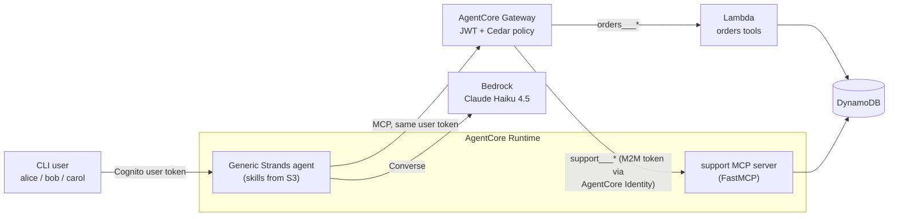

# ShopAssist: a generic, skills-driven agent on Amazon Bedrock AgentCore

ShopAssist is a low-cost proof of concept for architects and engineers evaluating **AgentCore Runtime,
Gateway, Identity and Policy**, delivered production-style: **Terraform**, arm64 **container images** in ECR, and
**GitHub Actions** with OIDC and a manual, approved deploy.

- A **generic Strands agent** with no business logic runs on AgentCore Runtime. Its behaviour comes
  from **skills** (`skills/*/SKILL.md`, loaded at runtime from S3 with the Strands `AgentSkills` plugin).
- Data and rule enforcement come from **MCP tools** behind **AgentCore Gateway**: a Lambda target
  (`orders`) and a FastMCP server on AgentCore Runtime (`support`).
- **Per-user access control** is enforced outside the agent: Runtime JWT claim check → token
  passthrough → Gateway JWT → AgentCore Policy (Cedar, `tools/list` filtered per user).
- Users sign in with **Cognito** (demo users) or, optionally, **Microsoft Entra ID** federated into Cognito; their
  directory groups decide what they may do ([docs/12](docs/12-entra-federation.md)).

The use case is customer support for a fictional online store: order status, returns and refunds,
and support tickets. A warehouse-stock lookup against a simulated on-prem API is planned (not built yet).

## Architecture in 30 seconds



Details: [docs/03-architecture.md](docs/03-architecture.md).

## Demo users

| User | Cognito group | Agent access | Tools |
|---|---|---|---|
| `alice` | `Group-ShopAssist-Admin` | ✅ | All 7 |
| `bob` | `Group-ShopAssist-Viewer` | ✅ | Read-only: `get_order`, `list_customer_orders`, `check_return_eligibility`, `get_ticket`, `search_faq` |
| `carol` | none | ❌ HTTP 403 at the Runtime, before any agent code runs | None |

The deploy creates these users with random passwords; Terraform writes them to `.deploy/<env>/users.json`
(git-ignored) on the machine that runs it ([docs/04 §4](docs/04-deploy-terraform.md#4-getting-deployenv-on-your-machine)).

## Quick start

### Local (no AWS deployment, real Bedrock)

You need [uv](https://docs.astral.sh/uv/) and AWS credentials that can invoke
`us.anthropic.claude-haiku-4-5-20251001-v1:0` in `us-east-1`:

```bash
uv sync
uv run python scripts/local_gateway.py --port 8765                        # terminal 1: Gateway emulator, in-memory data
uv run python scripts/run_local.py --gateway-url http://localhost:8765/mcp  # terminal 2: chat with the agent
```

Try "Where is order 1042?", "I want to return the headphones from order 1042", "Can I return the
smartwatch from order 1004?" or "My order 1006 hasn't arrived, I'm C003". The emulator's default port
is 8000, so pass `--port` if 8000 is taken. Start it with `--role viewer` to see bob's read-only
experience. `run_local.py --prompt "..."` sends one message and exits.

**Browser chat instead of the terminal:** run the agent as an HTTP server and open the chat UI, which
has clickable sample conversations per user ([docs/11-chat-ui.md](docs/11-chat-ui.md)):

```powershell
uv run python scripts/local_gateway.py --port 8765                       # terminal 1 (add --role viewer for bob)
$env:PYTHONIOENCODING="utf-8"; $env:GATEWAY_AUTH_MODE="none"; $env:GATEWAY_URL="http://localhost:8765/mcp"
$env:SKILLS_DIR="$PWD\skills"; $env:AWS_REGION="us-east-1"
uv run python agent/app.py                                               # terminal 2: agent on :8080
uv run python scripts/chat_ui.py --local --open                          # terminal 3: http://127.0.0.1:8790
```

In the page, click *Dummy token: alice (admin)* or *bob (viewer)*. Locally the token isn't checked:
the tools come from the emulator's `--role`.

This flow has been tested end to end with Bedrock: an eligible return (1042), a refused
out-of-window electronics return with a ticket offer (1004), a ticket (1006), an off-topic
redirect, and the viewer role explaining the missing permission.

### Deploy to AWS

Deploys run only through GitHub Actions ([docs/10-ci-cd.md](docs/10-ci-cd.md)):

1. Open a pull request: tests, IaC checks, image builds and scans run, and a read-only Terraform plan is posted
   as a comment.
2. Merge: the same checks run on `main`. Nothing is pushed or deployed.
3. **Actions → deploy → Run workflow** (`target_env = prod`). Review the plan summary, approve, and the job pushes
   the images, applies Terraform with `image_tag = <git sha>`, and runs a smoke test.

Rollback = the same workflow with an older SHA. Terraform layout, one-time setup and local commands:
[docs/04-deploy-terraform.md](docs/04-deploy-terraform.md). Accounts: everything is deployed to `438750401181`;
local commands against it use `AWS_PROFILE=personal`, per command.

Smoke test from your machine (after recreating `.deploy/prod/`, see docs/04 §4):

```bash
uv run python scripts/invoke_agent.py --user alice --prompt "Where is order 1042?"
uv run python scripts/invoke_agent.py --user carol --prompt "Hello"     # expect HTTP 401/403
uv run python scripts/demo_access.py                                   # alice / bob / carol / direct-Gateway matrix
uv run python scripts/chat_ui.py --open                                # browser chat
uv run python scripts/invoke_agent.py --login                          # sign in with Entra ID (when enabled)
```

## Repository layout

| Path | Contents |
|---|---|
| `agent/` | Generic agent: `app.py` (Runtime entrypoint), `skill_binding.py` (skill→tool binding hooks), `gateway_auth.py`, `skill_source.py`, `tools.py`, `config.py`; `Dockerfile`, `requirements.in` + `.lock.txt` |
| `skills/` | `order-tracking`, `returns-and-refunds` (+ `references/return-policy.md`), `support-ticketing` |
| `mcp_servers/` | `common/` (store, return rules), `orders_lambda/` (handler + `tools_schema.json`), `support_mcp/` (FastMCP server + `faq.json`); one `Dockerfile` each |
| `identity/role_mapper/` | Cognito pre-token-generation Lambda that maps Entra roles to Cognito groups |
| `data/seed.json` | Demo customers and orders (relative dates) |
| `scripts/` | Local use: `local_gateway.py`, `run_local.py`, `invoke_agent.py`, `oidc_login.py`, `chat_ui.py` + `.html`, `demo_access.py`, `seed_data.py`. Pipeline helpers: `ci_image_checks.sh`, `tf_plan_summary.py`, `pin_requirements.py`, `sync_gateway_target.py`, `log_group.py`, `leftovers.py`, `destroy_everything.sh` ([map](docs/10-ci-cd.md#7-file-by-file-map)) |
| `infra/terraform/` | `bootstrap/` (state bucket), `platform/` (ECR, OIDC, CI roles), the main stack + `modules/{data,identity,role_mapper,lambda_tools,mcp_runtime,gateway,agent_runtime}`, `envs/{dev,prod}.{tfvars,backend.hcl}` |
| `infra/policies/` | Cedar policy templates (who may call which tool) |
| `.github/` | Workflows `ci`, `build`, `deploy`, `destroy`, `_checks` and the `build-image` action |
| `tests/` | `uv run pytest` (offline; moto for DynamoDB) |
| `docs/` | The documentation below |
| `.kiro/` | Spec (`specs/strands-poc/design.md` holds the contracts) and steering rules |

## Documentation

1. [Use case](docs/01-use-case.md): scenario, personas, example conversations
2. [Agent capabilities](docs/02-agent-capabilities.md): skills, the 7 tools, return policy, guardrails, behaviour per role
3. [Architecture](docs/03-architecture.md): components, flows, generic-agent design, identity and access layers, security
4. [Deploy with Terraform](docs/04-deploy-terraform.md): the three stacks, rollouts, local access, destroy
7. [Cost](docs/07-cost.md)
8. [Extending with skills and tools](docs/08-extending-with-skills.md)
9. [Troubleshooting](docs/09-troubleshooting.md)
10. [Build, CI/CD and release](docs/10-ci-cd.md): workflows, images, OIDC roles, rollback, file-by-file map
11. [Browser chat UI](docs/11-chat-ui.md): local and deployed testing, getting a JWT from the AWS console
12. [Entra ID federation](docs/12-entra-federation.md): directory groups → app roles → Cognito groups
- [Deployment blueprint](docs/deployment-blueprint.md): this delivery setup as a reusable template (incl. mobile apps)

(Pages 5 and 6 described the removed boto3 deploy path.)

## Cost

Everything is serverless and on demand: AgentCore Runtime consumption billing, Gateway and Policy
per request, Lambda, DynamoDB on-demand, S3, and 7-day log retention. An idle stack costs close to
nothing (mainly one Secrets Manager secret and S3 storage). For about 100 demo conversations a month,
Bedrock tokens dominate and the total is roughly **single-digit dollars**. That figure is
illustrative: see [docs/07-cost.md](docs/07-cost.md) and the current
[Bedrock](https://aws.amazon.com/bedrock/pricing/) and
[AgentCore](https://aws.amazon.com/bedrock/agentcore/pricing/) pricing pages. An optional budget
alert is available (`enable_budget` and `budget_email` in `envs/prod.tfvars`).

## Teardown

- One environment: **Actions → destroy** (type `destroy prod`, approve). It removes the whole environment and then
  scans for leftovers; the free foundation stays so `deploy.yml` can recreate it.
- Everything, including the foundation: `AWS_PROFILE=personal bash scripts/destroy_everything.sh`.
- Check: `AWS_PROFILE=personal uv run python scripts/leftovers.py --region us-east-1 --all`.

Details: [docs/04-deploy-terraform.md §7](docs/04-deploy-terraform.md#7-destroy).
