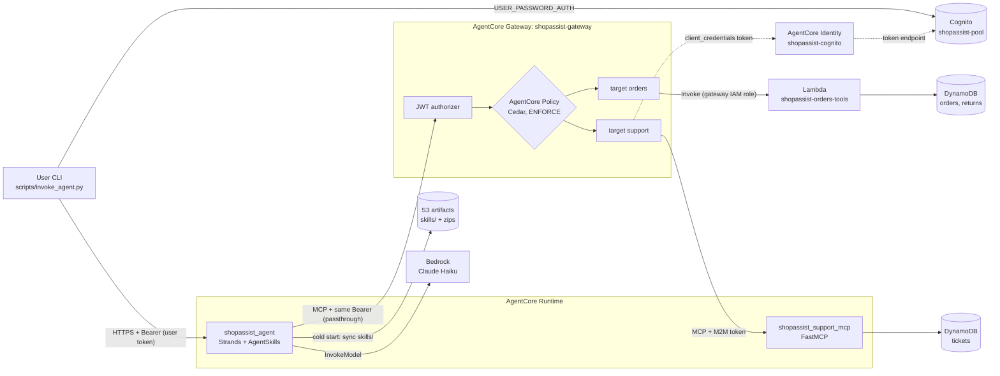
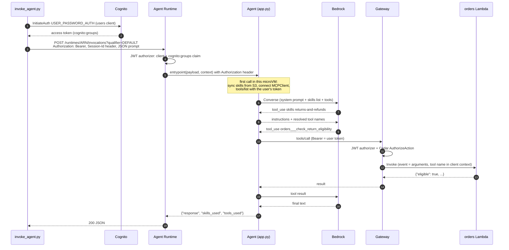
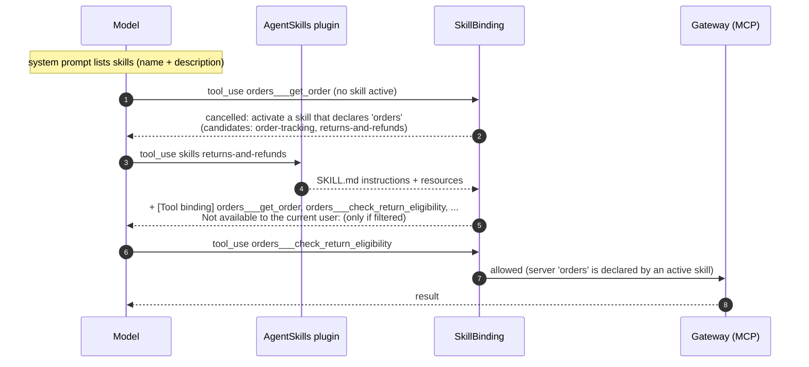
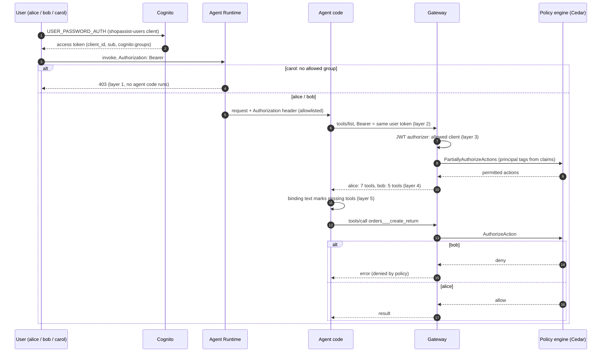
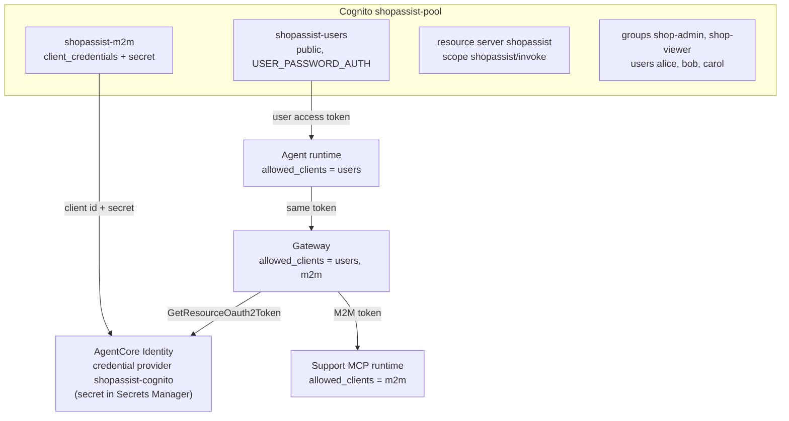

# 3. Architecture

The contracts (names, schemas, env vars) are in `.kiro/specs/strands-poc/design.md`. This page
explains how the pieces fit together and why.

## Components

| Component | AWS service | Code | Role |
|---|---|---|---|
| Client CLI | (your machine) | `scripts/invoke_agent.py` | Signs a demo user in to Cognito and calls the agent runtime over HTTPS with the user's Bearer token |
| Agent `shopassist_agent` | AgentCore Runtime, protocol HTTP | `agent/` | Generic Strands agent: AgentSkills plugin + MCP client to the Gateway + Bedrock model |
| Skills | S3 `s3://shopassist-artifacts-<account>-<region>/skills/` | `skills/` | Procedures, read by the agent at cold start |
| Model | Amazon Bedrock | n/a | `us.anthropic.claude-haiku-5-5` (inference profile, variable) |
| Gateway `shopassist-gateway` | AgentCore Gateway, protocol MCP, CUSTOM_JWT | n/a | One MCP endpoint over two targets, Cedar policy enforcement |
| Target `orders` | Lambda `shopassist-orders-tools` (python3.12, arm64) | `mcp_servers/orders_lambda/` | `get_order`, `list_customer_orders`, `check_return_eligibility`, `create_return` |
| Target `support` | AgentCore Runtime `shopassist_support_mcp`, protocol MCP | `mcp_servers/support_mcp/` | FastMCP server: `create_ticket`, `get_ticket`, `search_faq` |
| Policy engine `shopassist_policy_engine` | AgentCore Policy | `infra/policies/*.cedar` | Default-deny Cedar policies, per-user tool filtering |
| Credential provider `shopassist-cognito` | AgentCore Identity | n/a | Holds the M2M client secret; the Gateway uses it to get tokens for the `support` target |
| User pool `shopassist-pool` | Amazon Cognito | n/a | Users client (alice/bob/carol), M2M client, groups, `shopassist/invoke` scope |
| Tables | DynamoDB on-demand | `mcp_servers/common/store.py` | `shopassist-orders` (GSI `customer_id-index`), `shopassist-returns`, `shopassist-tickets` |
| Logs | CloudWatch Logs (7 days) | n/a | Runtime and Lambda log groups |



## Request flow



Notes:

- The session id header (`X-Amzn-Bedrock-AgentCore-Runtime-Session-Id`, at least 33 characters) picks
  the microVM. `invoke_agent.py` keeps one per user in `.deploy/session-<user>.txt`, so a
  conversation continues across runs. `--new-session` starts a new one.
- One Strands `Agent` lives per process, and the Runtime gives each session its own microVM. That
  gives you conversation memory per session without a memory store. Calls are serialised with a
  lock. See [Conversation memory](#conversation-memory) for how and how long it remembers.
- The response is `{"response": str, "skills_used": [...], "tools_used": [...]}`. The CLI prints the
  reply and then a dim `skills: ... | tools: ...` line.

## Generic agent design

`agent/` contains no domain words. Everything specific comes from skill files and the Gateway's tool
list.

| File | Responsibility |
|---|---|
| `app.py` | `BedrockAgentCoreApp` entrypoint; builds the Strands `Agent` (Bedrock model, `MCPClient` to the Gateway, `read_skill_resource`, plugins `AgentSkills` + `SkillBinding`); generic system prompt; rebuilds the agent when the caller changes |
| `config.py` | `Settings.from_env()`: `MODEL_ID`, `AWS_REGION`, `GATEWAY_URL`, `GATEWAY_AUTH_MODE`, `SKILLS_S3_URI` / `SKILLS_DIR`, `COGNITO_*`, ... |
| `skill_source.py` | Sync `s3://.../skills/` to `/tmp/skills` (path-safe), or use `SKILLS_DIR` |
| `skill_binding.py` | Hybrid skill→tool binding hooks, startup validation, usage tracking |
| `gateway_auth.py` | `httpx.Auth` for the MCP connection: passthrough, client_credentials or none |
| `tools.py` | `read_skill_resource(skill_name, path)`, the only local tool |

### Skills with progressive disclosure

The agent uses the Strands built-in `strands.vended_plugins.skills.AgentSkills` plugin:

1. **Discovery.** Before each invocation the plugin adds an `<available_skills>` block (name +
   `description` of each skill) to the system prompt. Only that short text is always in context.
2. **Activation.** The model calls the `skills` tool with a skill name. The plugin returns the full
   `SKILL.md` instructions plus a list of the skill's resource files, and records the skill in
   `agent.state["agent_skills"]["activated_skills"]`.
3. **Resources.** The model reads `references/...` files on demand with `read_skill_resource`. It can
   only read files of activated skills, and path traversal is rejected.

### Hybrid tool binding

Skills must not hard-code Gateway details. A skill declares *which servers* it may use, and its text
uses *plain* tool names:

```yaml
---
name: returns-and-refunds
description: Use when a customer wants to return an item, ...
metadata:
  mcp-servers: "orders support"
---
... Call `check_return_eligibility` with the order id and sku ...
```

`SkillBinding` (a Strands plugin in `agent/skill_binding.py`) connects the two with three hooks:

| Hook | What it does |
|---|---|
| `AfterToolCallEvent` on `skills` | Appends a `[Tool binding]` block to the activation result: the exact Gateway names for the declared servers (`- orders___create_return — <description>`), plus `Not available to the current user: ...` for plain names the skill mentions that this caller doesn't have |
| `BeforeToolCallEvent` | A Gateway tool `<server>___<tool>` runs only if an activated skill declares `<server>`. Otherwise the call is cancelled with a message naming the skill(s) to activate. A plain name such as `create_return` gets a hint with the exact name. Non-Gateway tools (`skills`, `read_skill_resource`) are always allowed |
| `BeforeInvocationEvent` | Resets the per-invocation `skills_used` / `tools_used` lists |

At startup, `validate_skills` logs declared servers without tools and backticked tool names that
don't exist on a skill's declared servers. In passthrough mode these are logged at INFO, because
per-user filtering makes "missing" tools normal there. Otherwise they're logged as WARNING.



Why hybrid rather than putting full tool names in the skill: the skill stays portable (no target
prefix, no endpoint), the agent can still stop a skill from using servers it didn't declare, and the
model gets the exact names at the moment it needs them.

### Why the binding exists

Skills say `create_return`. The Gateway exposes `orders___create_return`, and which tools exist
depends on the caller. Something has to bridge the two:

| Option | What breaks |
|---|---|
| Full Gateway names in skills | Skills depend on Gateway target names. Renaming a target or moving a tool means editing every skill that mentions it |
| Plain names, and the model works out the mapping | Usually works, but not reliably: the model sometimes calls `create_return` as written and gets "unknown tool" |
| Plain names plus a resolver (`SkillBinding`) | One plugin to maintain |

What each part buys:

1. **The `[Tool binding]` block.** The most useful part. It gives the model exact names when it
   needs them, and it's what makes bob's experience work: his tool list has no `create_return`, but
   the returns skill still mentions it. "Not available to the current user: create_return" turns that
   gap into a clean "your account doesn't have permission", which `demo_access.py` scenario b checks
   for. Without it the skill points at a tool the model can't see.
2. **The pre-call check.** All 7 tools are registered for every request. The check makes the model
   activate a skill first, so it follows the skill's steps (for example eligibility before return). It
   also limits each skill to the servers it declares: a new skill uploaded to S3 that only declares
   `support` can't make the agent call `orders` tools. That matters because skills change behaviour
   without code review.
3. **Startup validation and usage tracking.** Typos in skill tool names show up in the logs.
   `skills_used` / `tools_used` feed the CLI's dim line and the `demo_access.py` pass conditions.

**It's a behaviour layer, not a security control.** It runs inside the agent process and guides the
model. Enforcement is outside the agent: Cedar hides and denies tools per user (scenario d), and
`create_return` re-checks eligibility server-side. Removing the binding wouldn't let bob do anything
new.

**Costs:** one plugin with three hooks tied to Strands' event API; the binding text is part of the
~800–1,000 tokens added on activation; and an occasional extra model call when a premature tool call
is cancelled and the model corrects itself.

**Could it go?** The pre-call check is the optional part, if you trust the model and the tools to
enforce step order. Dropping the whole plugin means full Gateway names in skills plus a generic
system-prompt rule ("if a tool a skill mentions isn't in your list, say the user lacks permission"):
simpler, but skills become tied to target names and the permission message depends on the model
following a general rule.

## Conversation memory

The agent remembers a conversation in process memory only. There is no memory store: the
"memory" is the message history of one Strands `Agent` object, and AgentCore Runtime keeps that
object alive by giving each session its own microVM.

```
session id ──► microVM ──► app.py process ──► AgentRuntime ──► Agent
                                                               ├─ messages  (conversation history)
                                                               └─ state     (activated skills)
```

Turn by turn:

1. **The client picks the conversation.** `invoke_agent.py` and the chat UI send
   `X-Amzn-Bedrock-AgentCore-Runtime-Session-Id`. The CLI keeps one id per user in
   `.deploy/session-<user>.txt`. The Runtime routes every request with that id to the same microVM.
2. **One agent per process.** The microVM runs one `app.py` process, which holds one `AgentRuntime`
   (`get_runtime()`), which holds one Strands `Agent` (`self._agent`).
3. **Built once, then reused.** The first message builds the agent (load skills, connect to the
   Gateway, list tools). After that `_agent_for()` returns the same object while the caller's token
   `sub` stays the same.
4. **Strands keeps the history.** `agent(prompt)` appends the user message to `agent.messages`, runs
   the model/tool loop, and appends the replies and tool results. The whole list goes to Bedrock on the
   next turn, so "and the other order?" makes sense.
5. **Skill state carries over.** Activated skills are recorded in `agent.state["agent_skills"]`, so a
   follow-up can use the returns skill without activating it again.

| Limit | Effect |
|---|---|
| Not persisted | When the microVM ends, the conversation is gone. Sessions end after the Runtime's idle timeout or maximum lifetime. This repo doesn't set them, so the AWS defaults apply (check the current AgentCore docs for the values). A redeploy also starts fresh microVMs |
| History capped at 40 messages | Strands' default `SlidingWindowConversationManager` keeps the last 40 messages. Tool calls and results count, so a return flow fills the window quickly |
| Changing user resets it | A different token `sub` in the same process makes `_agent_for()` discard the agent and build a new one. Normally each user has their own session id, so this doesn't come up |
| One conversation per process | Requests take turns behind `self._lock`. Fine when each session has its own microVM. Locally (`run_local.py`, or `app.py` with `GATEWAY_AUTH_MODE=none`) there's one conversation per process whatever session id you send |
| Cost grows per turn | The full history is re-sent on every model call ([07-cost.md](07-cost.md)) |
| Starting fresh | `--new-session`, `/new` or the chat UI's *New session*: a new id means a new microVM and an empty history |

**Memory across sessions** needs storage outside the microVM: AgentCore Memory (managed short- and
long-term memory), or a Strands session manager that saves `messages` and `state` to S3 or DynamoDB
keyed by session id. Either also survives idle timeouts and redeploys. Neither is part of this PoC.

## Per-user access control

One agent, one Gateway, three users. The deployed stack enforces access in four layers, and the
agent adds a fifth, soft layer:

| # | Layer | Where | Decides | carol | bob | alice |
|---|---|---|---|---|---|---|
| 1 | Runtime inbound JWT authorizer + custom claim | Agent runtime | Who may use the agent: token from the users client, `cognito:groups` CONTAINS_ANY `shop-admin`, `shop-viewer` | 403 | pass | pass |
| 2 | Token passthrough | Agent code (`GATEWAY_AUTH_MODE=passthrough`) | The Gateway sees the *user*, not the agent | n/a | bob's token | alice's token |
| 3 | Gateway inbound JWT authorizer | Gateway | Token is from the users client (or the M2M client, for local dev) | n/a | pass | pass |
| 4 | AgentCore Policy (Cedar), ENFORCE, default deny | Gateway | Which tools each principal can list and call; `tools/list` is filtered | n/a | 5 read-only tools | all 7 |
| 5 | Skill guidance | Skills + binding text | How the agent explains a missing permission | n/a | "your account doesn't have permission" | n/a |



Details that matter:

- **Users client vs M2M client.** `shopassist-users` is a public client (no secret,
  `ALLOW_USER_PASSWORD_AUTH`). Its access tokens carry `cognito:groups`. `shopassist-m2m`
  (client_credentials, secret, scope `shopassist/invoke`) is used only by the Gateway→support-MCP
  outbound OAuth and for local development against the real Gateway.
- **A runtime with a JWT authorizer doesn't accept SigV4.** That's why `invoke_agent.py` calls the
  HTTPS invocation URL directly with a Bearer token. (`--sigv4` exists for runtimes without a JWT
  authorizer.)
- **Header allowlist.** `requestHeaderConfiguration.requestHeaderAllowlist = ["Authorization"]` is what
  lets the agent see the token at all. Without it, the agent answers "no Authorization header reached
  the agent" (`error: missing_authorization`).
- **Passthrough plumbing.** `bind_request_token()` puts the token into a contextvar *and* a
  process-wide relay. The relay is needed because Strands' `MCPClient` runs on a background thread whose
  context was copied when the client started. The agent caches its tool list per token `sub` and
  rebuilds the MCP client and agent when the `sub` changes.
- **Cedar specifics.** The principal type is `AgentCore::OAuthUser`. JWT claims become string tags,
  and arrays arrive as JSON text, so the policies match with
  `principal.getTag("cognito:groups") like "*\"shop-admin\"*"`. Actions are Gateway tool names
  (`AgentCore::Action::"orders___get_order"`). The viewer policy lists allowed actions instead of
  forbidding the write ones, so a new tool is denied for viewers by default.
- **Templates.** `infra/policies/admin_all_tools.cedar`, `viewer_read_only.cedar` and
  `m2m_dev_client.cedar` have `{{GATEWAY_ARN}}` / `{{M2M_CLIENT_ID}}` placeholders, filled by both
  Terraform (`replace()`) and boto3. The file name becomes the policy name.
- **Ordering.** Policy engine → Gateway (with `policyEngineConfiguration`, mode `ENFORCE`) → targets →
  policies. `CreatePolicy` validates action names against the Gateway's tools, so the targets must
  exist first.
- **Enforcement doesn't depend on the agent.** `scripts/demo_access.py` (design.md §8) calls the Gateway
  directly with bob's token (`tools/call orders___create_return`) and expects a denial.

## Identity design



| Hop | Inbound check | Credential |
|---|---|---|
| CLI → agent runtime | JWT authorizer: users client + `cognito:groups` claim | User access token |
| Agent → Gateway | JWT authorizer: users or M2M client, then Cedar | Same user token (passthrough) |
| Gateway → `orders` Lambda | IAM | Gateway execution role (`lambda:InvokeFunction`) |
| Gateway → `support` MCP runtime | JWT authorizer: M2M client | client_credentials token from the AgentCore Identity provider `shopassist-cognito` (scope `shopassist/invoke`) |
| Local dev → real Gateway (optional) | JWT authorizer: M2M client, Cedar `m2m_dev_client` | `GATEWAY_AUTH_MODE=client_credentials` with `COGNITO_TOKEN_URL`, `COGNITO_CLIENT_ID`, `COGNITO_CLIENT_SECRET` |

The credential provider (vendor `CustomOauth2`, Cognito discovery URL) stores the M2M client secret
in an AgentCore-managed Secrets Manager secret. The Gateway role can call
`GetWorkloadAccessToken` / `GetResourceOauth2Token` and read that secret. The Cognito domain
`shopassist-<account>` must exist before the provider is created, because Cognito only advertises
`token_endpoint` in its discovery document once a domain is set.

The deployed agent role has no credential-provider (token vault) or Secrets Manager permissions:
in passthrough mode the agent never mints its own token. It only has the workload-identity token
APIs (`GetWorkloadAccessToken*`) that the Runtime uses with a JWT inbound authorizer. The runtime
still gets `OAUTH_PROVIDER_NAME` / `OAUTH_SCOPES` env vars, but the current agent code doesn't read
them.

## Data model

| Table | Key | Written by | Notes |
|---|---|---|---|
| `shopassist-orders` | `order_id` (S); GSI `customer_id-index` on `customer_id` (projection ALL) | `scripts/seed_data.py`; `create_return` sets `items[i].returned` | Order object as in [02](02-agent-capabilities.md#tool-catalogue) |
| `shopassist-returns` | `return_id` (S) | `create_return` | `return_id, order_id, customer_id, sku, reason, status, refund_amount, label_url, created_at` |
| `shopassist-tickets` | `ticket_id` (S) | `create_ticket` | `ticket_id, customer_id, order_id, subject, description, priority, status, created_at` |

All tables are `PAY_PER_REQUEST`. `data/seed.json` has 3 customers and 10 orders with relative dates.
`seed_data.py` resolves them to ISO dates and overwrites by key, so re-running it before a demo resets
the return windows. It doesn't touch returns or tickets. `mcp_servers/common/store.py` hides the
backend: `STORE=memory` (seeded in-process, used by the local emulator and tests) or DynamoDB.

## Packaging and deployment model

Direct code deployment, so no Docker or ECR is needed:

| Artifact | Built by `scripts/build.py` | Runs on | Entry point |
|---|---|---|---|
| `dist/agent.zip` | `agent/*` + `agent/requirements.txt` deps | AgentCore Runtime `PYTHON_3_12`, arm64 | `app.py` |
| `dist/support_mcp.zip` | `mcp_servers/support_mcp/*` + `common/` + deps | AgentCore Runtime `PYTHON_3_12`, arm64 | `server.py` (stateless streamable HTTP on `0.0.0.0:8000/mcp`) |
| `dist/orders_lambda.zip` | `handler.py` + `common/` (boto3 from the Lambda runtime) | Lambda python3.12, arm64 | `handler.lambda_handler` |

- Dependencies are installed with `uv pip install --target ... --python-platform aarch64-manylinux2014
  --python-version 3.12 --only-binary=:all:`, so you can build on Windows or x86 and run on arm64.
- Zip entries use forward slashes and Unix permissions regardless of the build OS.
- Zips go to `s3://<bucket>/artifacts/`. The bucket is versioned, and the runtimes and the Lambda pin
  the object version, so a rebuilt zip becomes an in-place update.
- Skills go to `s3://<bucket>/skills/` separately. A skill change needs no new zip, only a new
  session.

## Observability

| Signal | Where |
|---|---|
| Agent logs (skills loaded, Gateway tools visible to the caller, blocked tool calls, errors) | CloudWatch `/aws/bedrock-agentcore/runtimes/<agent-runtime-id>-DEFAULT` |
| Support MCP server logs | `/aws/bedrock-agentcore/runtimes/<mcp-runtime-id>-DEFAULT` |
| Lambda tool calls (`tool=... args=[...]`, argument names only) | `/aws/lambda/shopassist-orders-tools` |
| Per-reply usage | `skills_used` / `tools_used` in every response, printed by the CLIs |
| Gateway target errors | Returned to the caller in detail because Terraform sets the Gateway `exception_level = "DEBUG"` (drop this in production) |
| Metrics, traces | Runtime roles may write X-Ray segments and CloudWatch metrics in the `bedrock-agentcore` namespace |

The deploy code creates every log group with 7-day retention. The agent zip doesn't include an
OpenTelemetry distro, so you get logs but no automatic agent spans in CloudWatch GenAI
observability. To get traces, add `aws-opentelemetry-distro` to `agent/requirements.txt` and enable
CloudWatch Transaction Search in the account.

Locally, `scripts/run_local.py --verbose` turns on debug logging, including the binding decisions.

## Security notes and production hardening

What the PoC already does:

- Access is enforced outside the agent: Runtime JWT + claim rule, Gateway JWT, Cedar default deny with
  filtered `tools/list`.
- Business rules (eligibility) are enforced in the tool, and `create_return` re-checks.
- Trust policies for AgentCore roles use `aws:SourceAccount` / `aws:SourceArn` (confused-deputy
  guard). Each role only gets its own tables, its own zip and the skills prefix.
- The S3 bucket blocks public access. Secrets live in the AgentCore-managed secret, and
  `.deploy/` (users file, outputs, session ids) is git-ignored.
- Skills can't name endpoints or credentials. They only name servers the Gateway already exposes,
  and the binding blocks undeclared servers.
- `read_skill_resource` is path-traversal safe.

What to change before production:

| Area | PoC choice | Production |
|---|---|---|
| Customer identity | The customer id is whatever the user types; the agent doesn't bind it to the caller | Derive the customer from the token (claim) and enforce it in the tools or Cedar (e.g. a `customer_id` tag condition) |
| User sign-in | `USER_PASSWORD_AUTH`, passwords in `.deploy/users.json` (and in Terraform state) | Hosted UI / authorization code + PKCE, MFA, no passwords on disk |
| Prompt injection | Tool output and FAQ text are trusted | Bedrock Guardrails, output validation, treat tool text as data |
| Gateway errors | `exception_level = DEBUG` (Terraform) | Default (no details to callers) |
| Network | `PUBLIC` network mode | VPC mode, VPC endpoints, private DynamoDB access |
| State | Local Terraform state / `infra/boto3/state.json` | Remote state (S3 + locking), CI pipeline |
| Tokens | 60-minute Cognito access tokens; `invoke_agent.py` signs in again on every run | Short-lived tokens, refresh, revocation |
| Policy rollout | Straight to `ENFORCE` | Try changes in `LOG_ONLY` first, then switch to `ENFORCE` |
| Data | Fake labels, no PII protection | Encryption with CMKs, PITR, retention rules, PII redaction in logs |
| Observability | Logs only | OTEL traces, dashboards, alarms on errors and policy denials |
| Least privilege | `dynamodb:Scan` is granted though unused | Trim actions to what the code calls |
| Conversation memory | In-process only, per microVM; lost on idle timeout or redeploy; 40-message window | AgentCore Memory or a Strands session manager (S3/DynamoDB); set explicit Runtime lifecycle timeouts |
