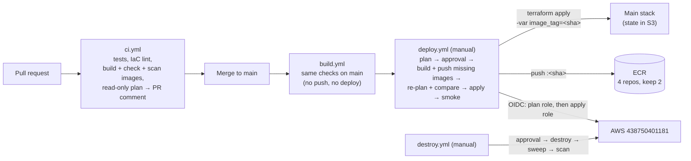

# 10. Build, CI/CD and release

How a code change gets from a pull request into AWS. Everything here runs in **GitHub Actions**;
nothing is built or deployed from a developer machine. Terraform itself is described in
[04-deploy-terraform.md](04-deploy-terraform.md). A reusable, app-agnostic summary of the same setup is in
[deployment-blueprint.md](deployment-blueprint.md).

## 1. The flow in one picture

Rules behind it (decisions of 2026-11-06/07, see `.kiro/steering/decisions.md`):
- **Terraform is the only deploy path**, including image rollouts (`-var image_tag=<sha>`).
- **Images are built only in GitHub Actions**, on native arm64 runners, and tagged with the full git SHA.
  ECR tags are immutable.
- **Only the deploy job pushes images.** So ECR only ever holds deployed images, and it keeps exactly
  two per repository: current + previous (= the rollback target).
- **Deploys are manual and approved.** Merging never deploys.
- **No AWS keys in GitHub.** Workflows get short-lived credentials through OIDC.
- **Public-repo logs stay clean.** Terraform's full output is never printed or uploaded.

## 2. The workflows

| File | Trigger | Jobs | AWS access |
|---|---|---|---|
| `.github/workflows/_checks.yml` | called by `ci.yml` and `build.yml` (`workflow_call`) | `test` (pytest + lock-file drift check), `iac` (terraform fmt/validate for the 3 stacks, tflint, checkov report-only), `images` (4 legs on `ubuntu-24.04-arm`: build, start + check, Trivy scan) | none |
| `.github/workflows/ci.yml` | pull request to `main` | the checks, plus `plan`: a read-only `terraform plan` of prod with the PR's SHA, posted as a PR comment (addresses + actions only). Skipped for fork PRs | plan role |
| `.github/workflows/build.yml` | push to `main` (after a merge), or manual | the checks again on the merged commit; the job summary shows the SHA that is ready to deploy | none |
| `.github/workflows/deploy.yml` | **manual** (`workflow_dispatch`): `target_env` (prod/dev), `image_tag` (empty = this commit) | `prepare` → `plan` → `deploy` (see below) | plan role, then apply role |
| `.github/workflows/destroy.yml` | **manual**: `target_env`, `confirm` (type `destroy prod`), `delete_images` | `prepare` → `plan -destroy` → `destroy` + sweep + scan | plan role, then apply role |
| `.github/actions/build-image/action.yml` | used by `_checks.yml` and `deploy.yml` | build one image for linux/arm64 → `scripts/ci_image_checks.sh` → Trivy | none |

### deploy.yml step by step

1. **prepare**: checks that `image_tag` is 40 hex characters and is on `main`; for prod, checks that the GitHub
   environment still has a required reviewer (it was once switched off by accident, so the workflow now
   refuses to run without one); runs the unit tests.
2. **plan** (plan role, read-only): `terraform plan -var image_tag=<sha>`. The full output goes to a private
   file; only the summary from `scripts/tf_plan_summary.py` (resource addresses and actions, no values) is
   shown. That summary is what you approve.
3. **deploy** (GitHub environment `prod` → **waits for your approval**, then the apply role):
   1. ECR login; find which of the 4 images for `<sha>` aren't in ECR yet.
   2. Build, check and scan each missing image (same composite action as CI), then push it.
   3. Re-plan, compute the plan hash (`tf_plan_summary.py --hash`) and **stop if it differs** from the
      approved plan (something changed between approval and apply).
   4. `terraform apply` of that plan (output kept private). Terraform also re-syncs the Gateway's `support`
      target if that image changed.
   5. Smoke test: `scripts/demo_access.py --no-reseed --only b,c,d` against the new deployment.
   6. If it failed **before** Terraform started changing anything, delete the images it just pushed, so
      ECR still holds exactly current + previous.
   7. Always delete the local `.deploy/` files (they hold the demo passwords).

### Rollback

Run `deploy.yml` with `image_tag` = the previous full SHA. The images already exist in ECR, so nothing is
built; the plan shows the runtimes and Lambdas going back to the old image; approve; done. Reverting the
commit and deploying the new head works too.

## 3. How the images are built

| Image (ECR repo) | Dockerfile | Base | Runs as |
|---|---|---|---|
| `shopassist-agent` | `agent/Dockerfile` | `python:3.12-slim` (arm64) | AgentCore Runtime, HTTP on 8080 (`/invocations`, `/ping`) |
| `shopassist-support-mcp` | `mcp_servers/support_mcp/Dockerfile` | `python:3.12-slim` (arm64) | AgentCore Runtime, MCP on 8000 (`/mcp`) |
| `shopassist-orders-lambda` | `mcp_servers/orders_lambda/Dockerfile` | `public.ecr.aws/lambda/python:3.12-arm64` | Lambda, `handler.lambda_handler` |
| `shopassist-role-mapper` | `identity/role_mapper/Dockerfile` | `public.ecr.aws/lambda/python:3.12-arm64` | Lambda (Cognito pre-token trigger) |

- **Build context = the repo root**, with an **allow-list** `.dockerignore` per image (`<Dockerfile>.dockerignore`):
  only the files that image needs are sent to the build.
- **Pinned dependencies.** Each Python image installs from a `requirements.lock.txt` with hashes, generated
  from `uv.lock` by `scripts/pin_requirements.py` from a short `requirements.in`. CI runs
  `pin_requirements.py --check` and `tests/test_pinned_requirements.py`, so a lock file that drifts from
  `uv.lock` fails the build. After changing dependencies: `uv lock`, then
  `uv run python scripts/pin_requirements.py`, and commit both.
- The two `python:3.12-slim` images install OS security updates (`apt-get upgrade`) and run as a non-root user
  (`USER 10001`). The Lambda images use AWS's Lambda base image as is.
- **Checks** (`scripts/ci_image_checks.sh`): each image is started on the runner and called the way AWS would
  call it (agent `/ping`; support `initialize` + `tools/list`; Lambdas through the Lambda Runtime Interface
  Emulator). An image that doesn't start is never pushed.
- **Scan** (Trivy): fails on fixable HIGH/CRITICAL findings. Accepted exceptions live in `.trivyignore.yaml`,
  each limited to one CVE and one path, with a reason and an expiry date.
- `docker buildx --platform linux/arm64 --provenance=false`, GitHub Actions layer cache per image.

## 4. AWS access: OIDC roles

GitHub gives each job a signed token saying which repo, branch or environment it runs in. AWS trusts that
token issuer (the OIDC provider in `infra/terraform/platform/oidc.tf`) and lets a job assume a role only if the
token's `sub` claim matches the role's trust policy (`platform/iam_ci.tf`).

| Role | Assumable by | Can do |
|---|---|---|
| `shopassist-gha-plan` | pull requests from this repo, and `main` | read-only (no business data, no secret values) + Terraform state read and lock-file write |
| `shopassist-gha-apply-<env>` | **only** jobs in the GitHub environment `<env>` (prod has a required reviewer) | create/update/delete the `shopassist-<env>-*` resources, push/delete ECR images, the destroy sweep (`platform/iam_apply.tf`) |

Least privilege details: the apply role's permissions are scoped to `shopassist-*` names; `iam:PassRole` is limited
to the stack's own roles; every IAM role the main stack creates must carry the `shopassist-<env>-boundary`
permissions boundary, so the pipeline can't create a role more powerful than itself. Fork PRs get no OIDC
token at all, so they can't use any role.

## 5. GitHub settings

| Setting | Value |
|---|---|
| Repository variables | `AWS_REGION`, `AWS_PLAN_ROLE` (ARN), `DEPLOY_DEV` (`false`: dev deploys are off) |
| Environment `prod` | Required reviewer = you; deployment branches = `main` only; variable `AWS_APPLY_ROLE`; secrets below |
| Environment `dev` | No reviewer; variable `AWS_APPLY_ROLE` |
| Environment secrets (`prod`) | `TF_VAR_ENTRA_CLIENT_SECRET` (only when Entra is enabled) |

`terraform output github_variables_commands` in `infra/terraform/platform` prints the `gh variable set` commands.
Non-secret ids are variables, not secrets, because they are needed in logs and are harmless.
The demo users' passwords are created by Terraform during the deploy job, used by the smoke test and deleted
at the end of the job; they are never stored in GitHub.

## 6. Security and log hygiene

- Every third-party action is pinned to a commit SHA (with the version in a comment).
- `permissions:` is minimal per workflow: `contents: read`, `id-token: write` only where OIDC is used,
  `pull-requests: write` only for the PR-comment job. `actions/checkout` uses `persist-credentials: false`.
- No `pull_request_target` trigger anywhere (it would run fork code with secrets).
- Inputs reach the shell only through `env:` variables, after validation (no `${{ inputs.x }}` inside scripts).
- `concurrency`: one deploy/destroy per environment at a time, never cancelled half-way.
- Terraform plan/apply output goes to files that are never printed or uploaded; only
  `tf_plan_summary.py` output appears (addresses and actions, never values).

## 7. File-by-file map

Every file below has a header comment (What it does / Where it fits / Step by step / Key terms). Suggested
reading order for the pipeline: `deploy.yml` → `action.yml` → `ci_image_checks.sh` → `tf_plan_summary.py` →
`platform/iam_ci.tf` → `main.tf`.

| File | Used by | Purpose |
|---|---|---|
| `.github/workflows/*.yml` | GitHub | the five workflows above |
| `.github/actions/build-image/action.yml` | `_checks.yml`, `deploy.yml` | build + check + scan one image |
| `scripts/ci_image_checks.sh` | the build action | start an image and call it like AWS |
| `scripts/tf_plan_summary.py` | `ci.yml`, `deploy.yml`, `destroy.yml` | print a plan as addresses/actions; `--hash` to compare plans |
| `scripts/pin_requirements.py` | developers, `_checks.yml` | `uv.lock` → per-image `requirements.lock.txt`; `--check` for drift |
| `scripts/sync_gateway_target.py` | Terraform (`terraform_data.sync_gateway_targets`) | re-sync a Gateway target's tool list after an image change |
| `scripts/log_group.py` | Terraform (runtime modules) | set retention on, and delete at destroy, the log groups AgentCore creates itself |
| `scripts/seed_data.py` | Terraform (`module.data`), developers | load `data/seed.json` into the orders table |
| `scripts/demo_access.py` | `deploy.yml` (smoke), developers | the access-control scenarios a–d |
| `scripts/leftovers.py` | `destroy.yml`, `destroy_everything.sh` | find (and with `--sweep` remove) anything left of an environment |
| `scripts/destroy_everything.sh` | you, locally | remove every env, platform and bootstrap |
| `.trivyignore.yaml` | the build action | accepted scanner findings with expiry |
| `*/Dockerfile`, `*/Dockerfile.dockerignore` | the build action | image recipes and their allow-listed build context |
| `*/requirements.in`, `*/requirements.lock.txt` | Dockerfiles, `pin_requirements.py` | direct dependencies and their pinned, hashed lock |
| `infra/terraform/bootstrap`, `platform`, main + `modules/*`, `envs/*` | Terraform | see [04-deploy-terraform.md](04-deploy-terraform.md) |
| `infra/policies/*.cedar` | Terraform (`module.gateway`) | who may call which tool |

## 8. Troubleshooting the pipeline

| Symptom | Cause and fix |
|---|---|
| deploy/destroy stops at "has no required reviewer" | The `prod` environment lost its reviewer rule. Settings → Environments → prod → add yourself |
| "plan differs from the approved plan" | Something changed between approval and apply (a merge, a manual change in AWS). Run the deploy again and review the new plan |
| Trivy fails on a new CVE | Prefer a base-image or package update. Only if the finding can't be exploited in AWS, add it to `.trivyignore.yaml` with a reason and an expiry |
| `pin_requirements.py --check` fails | `uv.lock` changed: run `uv run python scripts/pin_requirements.py` and commit the lock files |
| The leftover scan lists a resource that is already gone | AWS's tag index can lag for a while after a delete. `leftovers.py` checks that each tagged ARN really exists; if one still shows, check it by name and re-run later |
| AccessDenied in apply | The apply role is least-privilege. Add the missing action in `platform/iam_apply.tf`, apply the platform stack locally (`personal`), re-run |
| Plan comment missing on a PR | Fork PRs get no OIDC token, so no plan; or `AWS_PLAN_ROLE` isn't set |

More in [09-troubleshooting.md](09-troubleshooting.md).

## 9. Verified runs

| Date | Run | Result |
|---|---|---|
| 2026-11-07 | PR checks + summary plan comment | ✅ images built, checked, scanned; nothing applied |
| 2026-11-07 | `build.yml` on 9567c7d | ✅ green, ECR still empty |
| 2026-11-07 | First prod deploy (run 42425427780) | ✅ images pushed, 53 added; smoke c, d ✅ (b fixed in the skill) |
| 2026-11-08 | Deploy (run 42436314030) | ✅ smoke b, c, d. ⚠️ ran without approval (reviewer rule missing), so the reviewer guard was added |
| 2026-11-08 | `destroy.yml` (run 42442965157) | ✅ 51 destroyed, sweep + scan CLEAN |

Still open (see `prod-deploy-tasks.md` P6): a second deploy as an in-place update, a rollback, and the negative
role checks.
