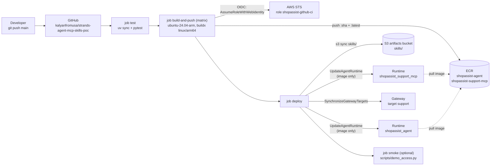

# 10. CI/CD with container images (optional)

By default both AgentCore runtimes use **direct code deployment**: `scripts/build.py` builds zips,
and Terraform or boto3 uploads them to S3 and points the runtimes at them. This page describes an
optional second delivery mode: **container images built by GitHub Actions**, pushed to ECR and
rolled out to the existing runtimes.

> Status: designed and checked offline (the images build for linux/arm64 locally, `terraform validate`
> passes, the workflow passes actionlint, and the rollout request is unit-tested against the botocore
> model). It hasn't been run against AWS or on GitHub yet.

## What changes and what doesn't

| | Zip mode (default) | Container mode |
|---|---|---|
| Artifact | `dist/agent.zip`, `dist/support_mcp.zip` in S3 | `shopassist-agent:<sha>`, `shopassist-support-mcp:<sha>` in ECR |
| Built by | `scripts/build.py` on your machine | GitHub Actions on a native arm64 runner (`agent/Dockerfile`, `mcp_servers/support_mcp/Dockerfile`) |
| Rolled out by | `terraform apply` / `infra/boto3/deploy.py` | the workflow: `scripts/ci/update_runtime_image.py` (UpdateAgentRuntime) |
| Infrastructure | Terraform or boto3 | still Terraform or boto3, applied **once**; the pipeline never runs Terraform |
| Orders Lambda | zip | zip (unchanged) |
| Code, entry points, ports | `app.py` on 8080 (`/invocations`, `/ping`), `server.py` on 8000 (`/mcp`) | identical |

The CI resources (ECR repositories, the GitHub OIDC provider, the CI role) live in a **separate,
optional** Terraform root, `infra/terraform/ci/`. The main stack gets a switch,
`artifact_type = "code" | "container"`. That switch isn't wired in yet: see
[ci-cd-integration-patch.md](ci-cd-integration-patch.md).

## Flow



Step by step (`.github/workflows/deploy.yml`):

1. **Trigger:** a push to `main` that touches `agent/**`, `mcp_servers/support_mcp/**`,
   `mcp_servers/common/**`, `skills/**`, `scripts/ci/**`, the workflow itself, `pyproject.toml` or
   `uv.lock`. Or a manual run (`workflow_dispatch`).
2. **test:** `uv sync --frozen` and `uv run pytest -q` (offline, using moto).
3. **build-and-push:** one matrix leg per image on `ubuntu-24.04-arm`. Each leg gets OIDC
   credentials for the CI role, runs `amazon-ecr-login` and `buildx build --platform linux/arm64`
   with the repo root as context and `-f <Dockerfile>`, then pushes `:<full sha>` and `:latest`.
   The layer cache lives in the GitHub Actions cache (`type=gha`, one scope per image).
   `provenance`/`sbom` are off, so ECR holds a plain single-platform image manifest.
4. **deploy:** checks the images exist, runs `aws s3 sync skills/ s3://<bucket>/skills/ --delete`, and
   then, in this order:
   1. `update_runtime_image.py update-runtime` for the **support MCP** runtime, waiting for the new
      version to be READY and live on the `DEFAULT` endpoint.
   2. `update_runtime_image.py sync-target --target-name support`, so the Gateway re-reads the
      tool list.
   3. `update_runtime_image.py update-runtime` for the **agent**. The agent goes last because its
      tool list comes from the Gateway.
5. **smoke (optional):** `scripts/demo_access.py --no-reseed --only b,c,d`. See [Smoke test](#smoke-test).

### Why "read, then update with everything the same"

`UpdateAgentRuntime` replaces the whole spec, not just the fields you send: an optional field left
out is reset. So the script calls `GetAgentRuntime` and copies every updatable field it returns
(`roleArn`, `networkConfiguration`, `protocolConfiguration`, `authorizerConfiguration`,
`requestHeaderConfiguration`, `environmentVariables`, `lifecycleConfiguration`, `description`, and
the rest of `PRESERVED_FIELDS`). Only `agentRuntimeArtifact` is replaced, with
`{"containerConfiguration": {"containerUri": ...}}`.
`tests/test_ci_update_runtime.py` fails if botocore ever adds an updatable field that the script
doesn't copy. Safety rails in the script:

- It refuses to switch a **code-mode** runtime to a container unless you pass `--allow-mode-switch`,
  because the next zip-mode `terraform apply` would switch it back.
- It's a no-op when the runtime already runs that exact image (`--force` overrides this).
- `--dry-run` prints the request without sending it.

## One-time setup

Prerequisites: the main stack is deployed (`.deploy/outputs.json` exists), and you have admin
credentials for the account plus `gh` (optional).

1. **Create the CI resources:**
   ```bash
   cd infra/terraform/ci
   terraform init && terraform apply          # set create_oidc_provider = false if the account already has one
   terraform output -raw github_variables_commands
   ```
2. **Set the GitHub repository variables** (Settings → Secrets and variables → Actions → *Variables*).
   Run the printed `gh variable set` commands, then add the ids from the main stack:
   ```bash
   # ids from .deploy/outputs.json: the runtime id is the last part of the runtime ARN (runtime/<id>)
   gh variable set AGENT_RUNTIME_ID       --body "shopassist_agent-XXXXXXXXXX"
   gh variable set SUPPORT_MCP_RUNTIME_ID --body "shopassist_support_mcp-XXXXXXXXXX"
   gh variable set GATEWAY_ID             --body "<gateway_id from outputs.json>"
   ```
   Optional variables: `BUILD_RUNNER`, `USE_QEMU`, `RUN_SMOKE`, `SMOKE_SCENARIOS`,
   `SUPPORT_TARGET_NAME`, `ECR_*_REPOSITORY` (see the header of `deploy.yml`). None of these are
   secrets, so they're variables. The only secrets are the smoke-test files.
3. **Push the first images.** The first images must exist before the main stack can point at them.
   Either push to `main` with `AWS_ROLE_ARN` set and the runtime variables still **unset** (build
   runs, deploy stops at "Check inputs and repository variables"), or build and push once by hand:
   ```bash
   aws ecr get-login-password | docker login --username AWS --password-stdin <account>.dkr.ecr.us-east-1.amazonaws.com
   docker buildx build --platform linux/arm64 --provenance=false -f agent/Dockerfile \
     -t <account>.dkr.ecr.us-east-1.amazonaws.com/shopassist-agent:<sha> --push .
   docker buildx build --platform linux/arm64 --provenance=false -f mcp_servers/support_mcp/Dockerfile \
     -t <account>.dkr.ecr.us-east-1.amazonaws.com/shopassist-support-mcp:<sha> --push .
   ```
4. **Switch the main stack to container mode** (after the integration patch is applied):
   ```hcl
   # infra/terraform/terraform.tfvars
   artifact_type        = "container"
   agent_image_uri      = "<account>.dkr.ecr.us-east-1.amazonaws.com/shopassist-agent:<sha>"
   support_mcp_image_uri = "<account>.dkr.ecr.us-east-1.amazonaws.com/shopassist-support-mcp:<sha>"
   ```
   Then `terraform apply`. **The switch replaces both runtimes:** the provider marks a change between
   `code_configuration` and `container_configuration` as *forces replacement*, so both get new
   runtime ids and ARNs. Terraform re-points the Gateway `support` target and rewrites
   `.deploy/outputs.json`. Afterwards, update `AGENT_RUNTIME_ID` and `SUPPORT_MCP_RUNTIME_ID`. From
   then on Terraform ignores `container_uri` (`lifecycle.ignore_changes`), so later applies leave the
   pipeline's image alone. Other changes (env vars, authorizer) are still in-place updates. This was
   checked with a Terraform plan against a hand-made state.
   With boto3: `uv run python infra/boto3/deploy.py --artifact-type container --agent-image ... --support-mcp-image ...`.
5. **Push to main.** Every push from now on rolls out automatically.

## Rollback

Every image is tagged with its full commit SHA. Run the workflow by hand with
`image_tag = <older full SHA>`. That skips the build, checks both images still exist in ECR,
syncs `skills/` **from that commit**, and rolls both runtimes back to those images. ECR keeps the last
5 images per repository (`ecr_keep_last_images`), so older SHAs can be gone. The check step fails
before anything changes in that case. Reverting the commit on `main` and pushing works too, and keeps
git and the deployment in step.

A faster emergency path is a new runtime *version* that points at the old image, with no workflow
needed:
`uv run python scripts/ci/update_runtime_image.py update-runtime --runtime-id <id> --image <repo>:<old sha>`.

## Smoke test

`scripts/demo_access.py` reads `.deploy/outputs.json` and `.deploy/users.json`, and those files don't
exist on a runner. The smoke job recreates them from two repository **secrets**,
`DEPLOY_OUTPUTS_JSON` and `DEPLOY_USERS_JSON` (paste the file contents). The users file holds the
demo passwords, which is why these are secrets. If the secrets are missing, the job logs a warning
and skips. It needs no AWS credentials: it signs the demo users in to Cognito (`InitiateAuth` is an
unauthenticated call) and calls the runtime and Gateway over HTTPS with their tokens. It runs
`--no-reseed` because the CI role has no DynamoDB access, and the default scenarios are `b,c,d`.
Scenario `a` creates a real return, so it only passes once per re-seed. Turn the job on with the
`run_smoke` input or `RUN_SMOKE=true`. If a deploy *replaces* the runtimes (the mode switch),
refresh `DEPLOY_OUTPUTS_JSON`.

## Security

- **No AWS keys in GitHub.** Jobs get one-hour credentials through OIDC. The role trust policy needs
  `aud = sts.amazonaws.com` **and** `sub = repo:kalyanfromusa/strands-agent-mcp-skills-poc:ref:refs/heads/main`,
  so pull requests, other branches and forks can't assume it. The workflow doesn't use a GitHub
  `environment:`, because that changes `sub` to `...:environment:<name>`. If you add one, add that
  subject to the trust policy.
- **Least privilege** (`infra/terraform/ci/iam.tf`): ECR push to the two repositories only, S3
  list/put/delete under `skills/` only, `Get/UpdateAgentRuntime` and `GetAgentRuntimeEndpoint` on the
  two runtimes, `List/GetGatewayTarget` and `SynchronizeGatewayTargets` on the Gateway, and
  `iam:PassRole` for the two runtime execution roles only, towards `bedrock-agentcore.amazonaws.com`.
  There are no Terraform, IAM-write, DynamoDB or Cognito permissions. By default the resources use
  the naming patterns (`shopassist_agent-*`). Set the exact ids in `terraform.tfvars` to tighten them.
- **Workflow hygiene:** `permissions: id-token: write, contents: read`. Actions are pinned to commit
  SHAs (with the version in a comment). `persist-credentials: false`. The manual `image_tag` input
  must be a 40-character hex SHA and only reaches shell commands through environment variables.
  `concurrency` stops two rollouts overlapping and never cancels one half-way.
- **Images:** `python:3.12-slim`, a non-root user (uid 10001), ECR scan on push, and an allow-list
  build context, so `.venv`, `.deploy/` and `dist/` can't end up in an image.

## Cost

| Item | Rough cost |
|---|---|
| ECR storage | ~$0.10/GB-month. Agent image ≈ 0.4 GB, support ≈ 0.1 GB (measured locally), × 5 kept ≈ 2.5 GB ≈ **$0.25/month** |
| ECR scan on push (basic) | free |
| GitHub Actions | Public repos: free. Private repos: billed minutes after the plan's free quota (arm64 runners have their own rate). A run takes about 5–10 minutes |
| GitHub Actions cache | free up to 10 GB per repository |
| AgentCore Runtime | unchanged (consumption-based). An image pull adds a little cold-start time, not cost |
| OIDC provider, IAM role | free |

`terraform destroy` in `infra/terraform/ci` removes everything. `force_delete` empties the repositories first.

## Caveats

- **Workshop Studio account.** Account 932637190076 is temporary and may block
  `iam:CreateOpenIDConnectProvider` or role creation, or already have a GitHub provider. Try
  `create_oidc_provider = false` first. If IAM is locked down entirely, OIDC isn't possible there, and
  the fallback is to run `update_runtime_image.py` locally with your workshop credentials. When the
  account expires, the GitHub variables point at nothing: delete or update them, and expect the
  workflow to fail at the AWS login.
- **arm64 runners for private repositories.** `ubuntu-24.04-arm` may not be available to private
  repositories on your plan. Set `BUILD_RUNNER=ubuntu-24.04` and `USE_QEMU=true`. That works, but
  emulation is slow: a cold local QEMU build of the agent image took **~14 minutes**, ~11 of which was
  byte-compiling the dependencies. The GHA layer cache makes later builds quick while
  `requirements.txt` is unchanged. You can also pass `--build-arg COMPILE_BYTECODE=0` (a faster
  build, but a slightly slower cold start).
- **Unpinned dependencies.** `agent/requirements.txt` uses `>=` ranges, the same as the zip build, so
  two builds of one commit can resolve different versions. To pin them, export from `uv.lock` (see
  open questions in the patch doc).
- **Skills: Terraform vs the pipeline.** The main stack also manages `skills/` objects
  (`aws_s3_object.skill`). The pipeline's `s3 sync` uploads the same content from the same commit, so
  the two agree. Terraform only shows drift if you apply from an older checkout.
- **Mode switch = replacement** (see setup step 4): new runtime ids, and existing sessions are lost.
- **Untested actions.** UpdateAgentRuntime might need more IAM actions on the caller (for example
  around workload identity) or ECR read access for the caller. If AWS returns `AccessDenied`, the
  error names the action. Add it to `iam.tf`.

## Zip vs container

| | Zip (direct code) | Container |
|---|---|---|
| Moving parts | S3 only | ECR, Docker build, OIDC, CI role |
| Build | `scripts/build.py`, cross-platform wheels via `uv --python-platform aarch64-manylinux2014` | A real arm64 Linux build: native wheels, any system package (`apt-get`), compiled extensions |
| Limits | Managed `PYTHON_3_12` runtime, zip size limits, pure wheels only | Any base image or language, bigger artifacts |
| Reproducibility | Zip pinned by S3 version id | Image pinned by tag or digest. Same image locally (`docker run`) and in AWS |
| Local parity | `run_local.py` on your OS | `docker run` of the exact deployed artifact |
| Rollout | `terraform apply` / `deploy.py` | Pipeline (`UpdateAgentRuntime`), with Terraform ignoring the image |
| Cold start | Small zip, fast | Image pull; slim base and pre-compiled bytecode help |
| Cost | ~free | ~$0.25/month ECR plus CI minutes |
| Good for | PoC, demos, a single developer | Team flow, push-to-deploy, native dependencies, audit trail (SHA = deployment) |
